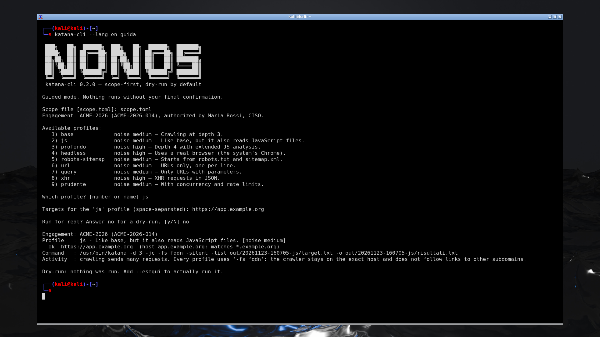
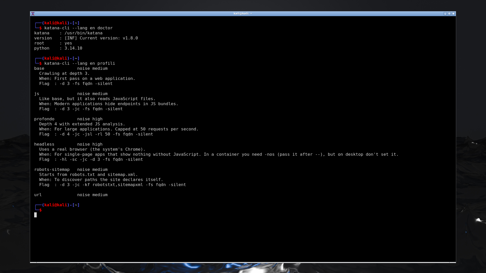
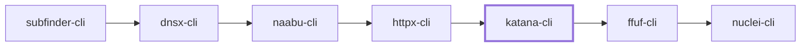

# katana-cli

🌐 [Italiano](README.md) · **English** · [中文](README.zh.md)

[](https://github.com/NON-OS/katana-cli/actions/workflows/ci.yml)


```
  ┌─ scope ─┐   ┌─ dry-run ─┐   ┌─ confirm ─┐   ┌─ katana ─┐   ┌─ audit ─┐   ┌─ report ─┐
  │ check   │ → │ show      │ → │ ticket    │ → │ runs    │ → │ chain   │ → │ summary  │
  └─────────┘   └───────────┘   └───────────┘   └─────────┘   └─────────┘   └──────────┘
```

Web crawling with a validated scope, dry-run by default and a hash-chained audit. Authorized targets only.

> **Only systems you own or have written authorization for.** Read [DISCLAIMER.md](DISCLAIMER.md) before you launch anything.

## What it is

`katana-cli` is a thin orchestrator around ProjectDiscovery's katana. It does not replace it. It checks the starting host against the scope and, above all, keeps the crawler inside that host: every profile uses `-fs fqdn`.

A crawler follows links, and links lead everywhere. Katana's default perimeter is the registrable domain (`rdn`): starting from `app.example.org` it can end up on `mail.example.org`, which may not be in scope. Checking only the seed is not enough. That is why the scope field is pinned to `fqdn` in the profiles and the `-fs`, `-cs` and `-ns` flags are forbidden.

## In action



*Guided mode (`katana-cli guida`) running on Kali Linux: logo, profile selection, scope validation, command preview. Real screenshot.*

```console
$ katana-cli --lang en lancia prudente https://app.example.org --scope scope.toml
Engagement: ACME-2026 (ACME-2026-014)
Profile   : prudente - With concurrency and rate limits. [noise medium]
  ok  https://app.example.org  (host app.example.org: matches app.example.org)
Command   : katana -d 3 -jc -c 10 -p 10 -rl 50 -timeout 10 -retry 1 -fs fqdn -silent -list out/esempio/target.txt -o out/esempio/risultati.txt
Activity  : crawling sends many requests. Every profile uses '-fs fqdn': the crawler stays on the exact host and does not follow links to other subdomains.

Dry-run: nothing was run. Add --esegui to actually run it.
```

With an out-of-scope target, even among valid ones, nothing runs:

```console
$ katana-cli --lang en lancia prudente https://app.example.org https://evil.example --scope scope.toml
katana-cli: targets out of scope, running nothing:
  https://evil.example: host evil.example: hostname not among the included ones
$ echo $?
3
```

The `lancia` command never runs without `--esegui`. What you see above is a preview.

The output follows the language you pick: `--lang it|en|zh` or the `NONOS_LANG` variable (handy for setting it system-wide). It always starts in Italian.

## What it does

| | |
|---|---|
| Scope | Domain, host or URL (`url` mode), with exclusions and validity dates. When in doubt, it refuses. |
| Dry-run | By default nothing runs. `--esegui` asks for confirmation. |
| Profiles | 9, each marked with its noise level and when to use it. |
| Flag filter | Flags that bypass the scope or seize control of the output are blocked. |
| List filter | `filtra` reads a list from stdin and lets through only what is in scope. |
| Signed scope | The client signs the scope with their SSH key. If the file changes after signing, nothing runs. |
| Audit | Hash-chained log. Scope hash and signer included, sensitive values masked. |
| Report | Summary of results as text, Markdown or JSON. |
| Diff | What changed between two runs, with an exit code for CI. |
| Dependencies | None: just the Python standard library. |

## Platform

Built for **Kali**, **Parrot** and Linux in general: that is where these tools live and where `katana-cli` gets used. It also runs on macOS. Windows is untested, and there some privilege checks (`os.geteuid`) do not apply.

## Installation

You need Python 3.11 or newer and katana on your `PATH`. Kali/Debian: sudo apt install katana. Anywhere with Go: go install github.com/projectdiscovery/katana/cmd/katana@latest

```sh
git clone git@github.com:NON-OS/katana-cli.git
cd katana-cli
python3 -m venv .venv && . .venv/bin/activate
pip install -e .
katana-cli doctor
```

## First use

### The simplest way: guided mode

`katana-cli guida` asks you one question at a time — scope, profile, target — shows the command preview, and launches nothing without your final confirmation. It is the recommended way to start:

```sh
katana-cli guida
```

### Or by command

```sh
katana-cli init scope.toml          # crea il modello
$EDITOR scope.toml               # compilalo con il cliente
katana-cli verifica https://app.example.org --scope scope.toml
katana-cli lancia prudente https://app.example.org --scope scope.toml            # dry-run
katana-cli lancia prudente https://app.example.org --scope scope.toml --esegui   # parte davvero
```

In a terminal, `--esegui` asks you to type the engagement ticket. In a script, use `--conferma`. Other katana flags go after `--`, unless they are among the forbidden ones ([docs/04-profili.md](docs/en/04-profili.md)).

A full flow:

```sh
katana-cli lancia js https://app.example.org --scope scope.toml --esegui
katana-cli rapporto out/*-js/ --formato markdown
```

## Commands

| Command | What it does |
|---|---|
| `guida` | step-by-step interactive mode: scope → profile → target → confirmation |
| `lancia <profilo> <target...>` | validates and builds (or runs) katana. With `-` it reads targets from stdin |
| `filtra` | reads targets from stdin and prints only those in scope |
| `verifica <target...>` | tells you whether the targets are in scope, without launching |
| `scope-firma <file>` / `scope-verifica <file>` | signs and checks the scope with an SSH key |
| `rapporto <file_or_dir>` | summary of results: discovered URLs |
| `confronta <old> <new>` | differences between two runs |
| `profili` | lists the profiles with their exact flags |
| `audit [file]` | verifies the log's hash chain |
| `init [file]` | creates a scope file to fill in |
| `doctor` | checks katana, version, privileges |

## Profiles

| Profile | What it does | Noise | Root |
|---|---|---|---|
| `base` | Crawling at depth 3. | medium | no |
| `js` | Like base, but it also reads JavaScript files. | medium | no |
| `profondo` | Depth 4 with extended JS analysis. | high | no |
| `headless` | Uses a real browser (the system's Chrome). | high | no |
| `robots-sitemap` | Starts from robots.txt and sitemap.xml. | medium | no |
| `url` | URLs only, one per line. | medium | no |
| `query` | Only URLs with parameters. | medium | no |
| `xhr` | XHR requests in JSON. | high | no |
| `prudente` | With concurrency and rate limits. | medium | no |



*`katana-cli doctor` (finds the real katana binary in `/usr/bin/`) and the profile list, on Kali Linux.*

## Exit codes

| Code | Meaning |
|---|---|
| 0 | all good |
| 1 | `confronta --exit-code` found differences |
| 2 | wrong arguments or a forbidden flag |
| 3 | at least one target out of scope |
| 4 | scope unreadable, malformed or expired |
| 5 | katana missing |
| 6 | run without confirmation, or a profile that needs root without sudo |
| 7 | katana exited with an error, or the audit chain is broken |

## The tool chain

This repository is one of eight, designed to work together. Each one checks the scope on its own.



- [subfinder-cli](https://github.com/NON-OS/subfinder-cli): subdomain enumeration
- [dnsx-cli](https://github.com/NON-OS/dnsx-cli): dns resolution
- [naabu-cli](https://github.com/NON-OS/naabu-cli): port scanning
- [httpx-cli](https://github.com/NON-OS/httpx-cli): http probes
- [ffuf-cli](https://github.com/NON-OS/ffuf-cli): path fuzzing
- [nuclei-cli](https://github.com/NON-OS/nuclei-cli): vulnerability scanning
- [nmap-cli](https://github.com/NON-OS/nmap-cli): port and service scanning with nmap

## Documentation

1. [Introduction and philosophy](docs/en/01-introduzione.md)
2. [Authorization: what you need before touching a target](docs/en/02-autorizzazione.md)
3. [The scope file](docs/en/03-scope.md)
4. [Profiles and forbidden flags](docs/en/04-profili.md)
5. [The audit log](docs/en/05-audit.md)
6. [Architecture](docs/en/06-architettura.md)
7. [Where to try it safely](docs/en/07-lab.md)
8. [Reports and diffs](docs/en/08-rapporti.md)
9. [Signed scope](docs/en/09-firma.md)
10. [Compatibility and testing](docs/en/10-compatibilita.md)

The shell cheatsheet the project grew out of is in [scripts/](scripts/).

## What it does not do

It does not find out whether you have permission: you declare that in the scope file, and the program takes your word for it. It does not protect against anyone who runs `katana` directly. The flag filter is a safety net against mistakes, not a sandbox. The details are in [docs/06-architettura.md](docs/en/06-architettura.md).

## Development

```sh
make check     # ruff (lint + format), mypy --strict, test e coverage
```

No runtime dependencies (just the standard library). Development tools install with `pip install -e ".[dev]"`. See [CONTRIBUTING.md](CONTRIBUTING.md) and [SECURITY.md](SECURITY.md).

## License

MIT, see [LICENSE](LICENSE). The license covers the code; it does not authorize any activity.
